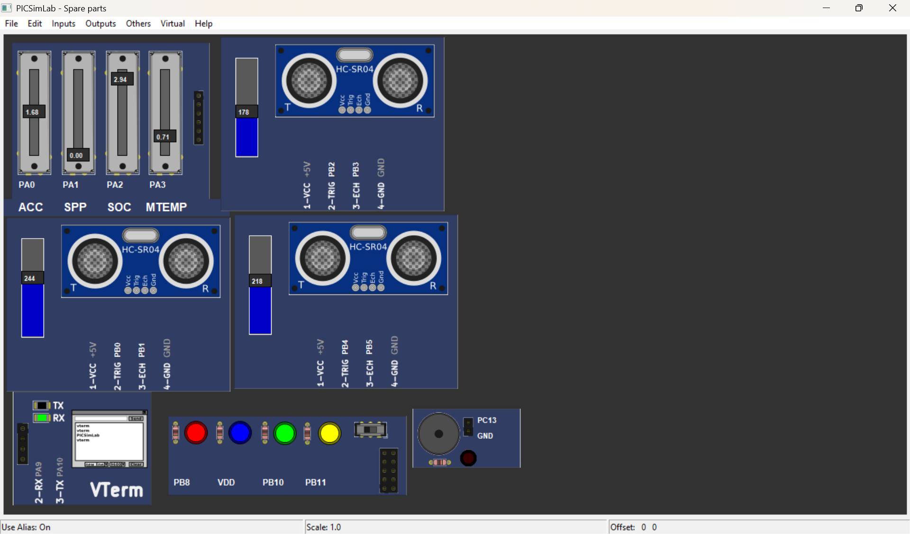

# EV ADAS System

## Internship Details
**Organization:** [Emertxe](https://www.emertxe.com)  
**Track:** Embedded Systems and Internet of Things (IoT)  
**Certificates & Documents:**
- [Internship Completion Certificate](documents/Internship%20Completion%20Certificate%20-%20Sri%20Charan%20Mittapelly.pdf)
- [Internship Offer Letter](documents/Offer%20Letter%20-%20Sri%20Charan%20Mittapelly.pdf)

> *This project was developed during my 2nd embedded internship at Emertxe as part of a virtual learning program.*

## Short Description
A real-time embedded Electric Vehicle Dashboard with an Ultrasonic Advanced Driver Assistance System (ADAS) Safety Engine, developed for the STM32 "Blue Pill" microcontroller.

## Objective
To model core electric-vehicle behaviour (torque, speed, regenerative braking, state-of-charge, and range) directly on embedded hardware and implement genuine ADAS safety functions using ultrasonic sensors. The project strictly enforces safe-state behaviour through a dedicated fault-management layer and streams live, structured telemetry over UART to a custom Python dashboard.

## Hardware / Components Used
- **Microcontroller**: STM32F103C8T6 "Blue Pill" (ARM Cortex-M3 @ 72 MHz)
- **Sensors**: 
  - 3 × HC-SR04 Ultrasonic Sensors (Front, Left, Right)
  - 3 × Potentiometers (Accelerator, Brake, Temperature)
- **Indicators**: Configurable Warning and Fault LEDs
- **Simulation Platform**: PICSimLab

## Images
### System Dashboard

### Virtual Hardware Setup
_bluepill.png)

## Circuit / Working Explanation
The architecture relies on a single, one-directional data pipeline:
1. **Sensing**: Analog signals (Accelerator, Brake, Temperature) are continuously sampled by the STM32's ADC. Ultrasonic sensors are triggered sequentially using hardware timers (TIM2).
2. **EV Dynamics Engine**: Evaluated every 10ms (using TIM1). It translates pedal inputs into motor torque and integrates it against aerodynamic drag to compute speed. It also updates State of Charge (SOC) dynamically based on power consumption and regenerative braking.
3. **ADAS Engine**: Runs every 100ms (using TIM3). It estimates distances, calculates Time-to-Collision (TTC), and raises prioritized alerts (Advisory, Warning, Critical) for Forward Collision Warning and Blind-Spot Detection. Hysteresis filtering prevents alarm chatter.
4. **Fault Management**: Constantly supervises operations. If a critical condition occurs (Motor Temp > 90°C, SOC < 2%, or Critical Collision < 20cm), it enforces a fail-safe state, cuts torque to zero, and latches a fault indicator.
5. **Telemetry & Dashboard**: The complete vehicle state is packed into two UART frames and streamed at 10 Hz (115200 bps). A Python Matplotlib dashboard running on the host parses this and provides a real-time cluster visualization.

## Results / Observations
- Successfully integrated physics-based EV logic with ADAS routines on a single constrained MCU.
- Forward collision warning operates reliably, accurately transitioning into a safe fault state at a 20 cm distance threshold.
- The Python dashboard seamlessly refreshes at 10 frames per second, showcasing instantaneous speed, SOC depletion/regeneration, and an ADAS bird's-eye view with zero noticeable lag.
- Deterministic UART shell allows for robust diagnostic fault injection and parameter overrides on the fly.

## Tools Used
- **Firmware Development**: STM32CubeIDE (STM32 HAL)
- **Simulation**: PICSimLab (Programmable IC Simulator Lab)
- **Dashboard Application**: Python, Matplotlib, PySerial
- **Protocols**: UART (115200 bps, 8N1)

## Challenges Faced
- **Deterministic Timing**: Managing multiple hardware timers (10ms EV integration, 100ms ADAS tick, and 1µs resolution stopwatch for HC-SR04 echo timing) without relying on a Real-Time Operating System (RTOS). 
- **Sensor Noise Mitigation**: Standardizing a 3-sample hysteresis filter to debounce ultrasonic sensor readings and avoid erratic dashboard alarm toggling.
- **Handling MCU Constraints**: Structuring non-blocking data flows to process heavy ADAS metrics and UART streaming reliably without overloading the ARM Cortex-M3 core.
